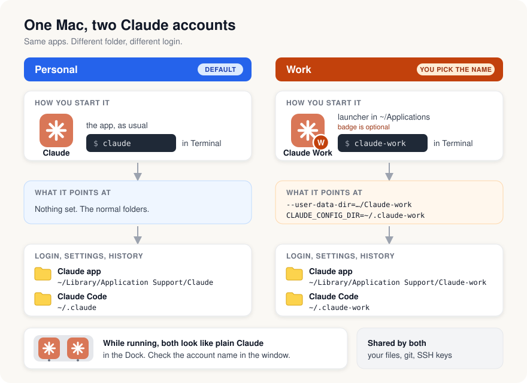

# Mac how-to: a Personal and a Work Claude account, side by side

Run two Claude accounts on one Mac at the same time: your **Personal** account the way you launch Claude today, and a **Work** account (call it whatever you like) from its own launcher and its own terminal command. No logging out and back in.

> [!CAUTION]
> **You only live once: just let Claude do it.**
>
> This hands your Mac to Claude Code with permission checks turned off. It will download files, write scripts, run them, and edit `~/.zshrc` without asking first. It's all in your home folder and all undoable, but read what it says as it goes.
>
> **1. Start Claude Code in your home folder, on Opus at High effort.** In Terminal:
>
> ```bash
> cd ~ && claude --model opus --effort high --dangerously-skip-permissions
> ```
>
> No `claude` command yet? Install it with `curl -fsSL https://claude.ai/install.sh | bash`, open a new Terminal window, and run the line above. Or skip the terminal: in the Claude app's **Code** tab, pick your home folder, Opus, High effort, and the permission mode that doesn't ask (bypass permissions).
>
> **2. Paste this prompt:**
>
> ```text
> Read https://github.com/GaryRudolph/public/blob/main/howtos/mac-two-claude-accounts.md and set up this Mac so I can use a Personal and a Work Claude account side by side, following it. Before changing anything, ask me the questions in its "Choices" section and explain the tradeoffs. Then do the work yourself, and stop whenever I need to sign in or click something.
> ```
>
> **What it will touch:** `~/Applications/Claude Work.app`, `~/.claude-work/`, `~/Library/Application Support/Claude-work/`, one line in `~/.zshrc`, and `~/Projects/claude-accounts/`, where it leaves a `README.md` saying what it did, why, and how to undo it. Your Personal setup isn't changed.



## Choices

Claude will ask you these before it changes anything.

**1. What's the second account called?** Default is **Work**. That gives you a `Claude Work` app and a `claude-work` command. Personal stays the default: anything you launch the normal way is Personal.

**2. What do you want set up?**

| Option | You get | Good for |
|---|---|---|
| **A. Claude app only** (recommended start) | A `Claude Work` launcher in `~/Applications`. Click it and the Claude app opens on your Work account, including its Code tab. | Most people. Everything happens in the app. |
| **B. App + terminal command** | A, plus `claude-work` in Terminal for Claude Code on the Work account. Plain `claude` stays Personal. | You also run Claude Code in a terminal. |
| **C. Terminal command only** | Just `claude-work`. No launcher, nothing built. | You only use Claude Code in a terminal. |

**3. Branded icon or plain?** (A and B only)

| | Branded | Plain |
|---|---|---|
| Launcher icon | The Claude icon with a colored badge (a "W" for Work) | The stock Claude icon |
| Told apart by | The badge and the name `Claude Work` | The name `Claude Work` only (Spotlight, Launchpad, the label on a pinned Dock icon) |
| Extra work | Claude draws the badge with a script built into macOS | None, it copies the stock icon |

Either way, nothing extra gets installed: no Xcode tools, no Homebrew, no ImageMagick.

**The catch with both:** the badge is only on the launcher you click. Once the app is running, both copies show the plain Claude icon and the name "Claude" in the Dock, Cmd-Tab, and the menu bar, and macOS has no way to change that. Tell them apart by the account name inside the window (bottom left of the sidebar).

## How it works

The Claude app and Claude Code each keep your login, settings, and history in a folder. Launch them normally and they use the default folder, which is Personal. The Work launcher and the `claude-work` command start the exact same programs, pointed at a second folder. Different folder, different login.

| | Personal (default) | Work |
|---|---|---|
| How you start it | `Claude` app as usual, `claude` in Terminal | `Claude Work` launcher, `claude-work` in Terminal |
| Claude app data | `~/Library/Application Support/Claude` | `~/Library/Application Support/Claude-work` |
| Claude Code data | `~/.claude` (and `~/.claude.json`) | `~/.claude-work` |

The app's Code tab follows the app: Code sessions in `Claude Work` use `~/.claude-work`, the same folder `claude-work` uses, so they share settings and history.

Still shared between the two: your files, git, SSH keys, and the rest of your home folder. Only the Claude logins are separate.

The engineer's version, with every flag, lives in [`macos-launchers/README.md`](../macos-launchers/README.md).

## Instructions for Claude

You're setting this up for someone who isn't an engineer. Explain in plain words, keep updates short, and do the work yourself. Use your judgment where this doesn't cover something; the outcome below is what matters.

**Ask first.** Ask the three Choices questions in one go, with the tradeoffs in your own words, and wait for answers. From the name, derive a slug (lowercase, `work`) and a badge letter (`W`). Check that `/Applications/Claude.app` exists for options A and B; if it doesn't, have them install the Claude app first.

**Only what ships with macOS.** Don't install Xcode command line tools, Homebrew, or ImageMagick, and don't run `git`, `make`, or `python3`: on a stock Mac those are stubs that pop up an Xcode install. Use `curl`, `tar`, `zsh`, `osacompile`, `plutil`, `sips`, `iconutil`, and `osascript`. If they picked a plain icon, no image work is needed beyond copying the stock icon.

**Get the reference code.** Download the repo tarball (`https://github.com/GaryRudolph/public/archive/refs/heads/main.tar.gz`) into a temp folder and note the commit (`https://api.github.com/repos/GaryRudolph/public/commits/main`). Read `macos-launchers/apps/claude.applescript` and the `install` recipe in `macos-launchers/Makefile`; that's the tested recipe, so follow it rather than inventing one. Don't use its `profiles/` (they're Gary's) and don't push anything anywhere.

**Build the launcher (A, B).** In `~/Projects/claude-accounts/`, write `install.sh` and `uninstall.sh` (zsh, re-runnable) and run `install.sh`. It should:

- render the AppleScript template with their slug and `osacompile` it to `~/Applications/Claude <Name>.app`;
- set its icon from `/Applications/Claude.app`'s icon (find it with `plutil` on its `Info.plist`): unchanged for plain, or with a colored circle and the badge letter in the bottom right for branded, drawn with JXA (`osascript -l JavaScript`, `ObjC.import('AppKit')`, `NSImage`/`NSBitmapImageRep`);
- build the `.icns` with `sips` and `iconutil` and handle the same quirks the Makefile does: write both `applet.icns` and `droplet.icns`, delete `Assets.car`, `touch` the app, and restart the Dock.

**Add the terminal command (B, C).** Append to `~/.zshrc` (or their shell's startup file if it isn't zsh):

```bash
# Work Claude account; see ~/Projects/claude-accounts/README.md
alias claude-work='CLAUDE_CONFIG_DIR="$HOME/.claude-work" claude'
```

**Leave a record.** Write `~/Projects/claude-accounts/README.md` for them or a future agent: a link to this how-to and the commit you read, the date, their three answers, every file and folder you created or changed outside that folder, how to rebuild (`zsh install.sh`), and how to undo (below). Short and plain.

**Walk them through signing in.** The Claude app signs in through a `claude://` link, and with two copies installed macOS can hand that link to the wrong one, so sign-in silently fails. For the first Work sign-in only:

1. Quit every Claude window (Cmd-Q).
2. System Settings → Desktop & Dock → Default web browser → Safari.
3. Open `Claude Work` and sign in with the Work account.
4. Set the default browser back.

Then for B and C: open a new Terminal window, run `claude-work`, and sign in with the Work account.

**Check it.** Both apps open at the same time, on different accounts. `claude-work` then `/status` shows the Work account; plain `claude` shows Personal. Suggest they drag `Claude Work` from `~/Applications` to the Dock. Finish with a short plain-language summary: what they have, how to open each, and where the README is.

## Gotchas

- **Sign-in goes nowhere.** That's the `claude://` link going to the wrong copy. Use the Safari steps above. It only matters the first time.
- **Running icons look the same.** Expected. Look at the account name in the window.
- **Quitting `Claude Work` from the Dock doesn't close it.** The launcher only starts the app and exits. Cmd-Q the Claude window itself.
- **Work app shows Personal Code history.** Check the app's Settings for an environment variable named `CLAUDE_CONFIG_DIR`; if one is set there, it overrides the launcher. Remove it.
- **A change didn't take.** The app reads its settings when it starts. Quit it with Cmd-Q and open it again from the launcher.

## Undo

Start from `~/Projects/claude-accounts/README.md`, which lists exactly what was done on your Mac. In short: run `zsh ~/Projects/claude-accounts/uninstall.sh`, delete the `claude-work` lines from `~/.zshrc`, and if you want the Work login and history gone too, delete `~/.claude-work` and `~/Library/Application Support/Claude-work`. Or paste that README into Claude Code and ask it to undo everything.
