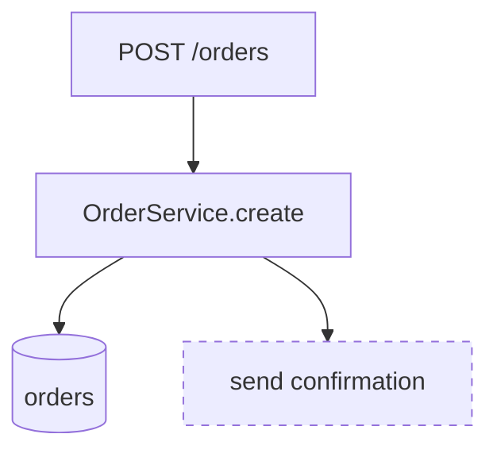
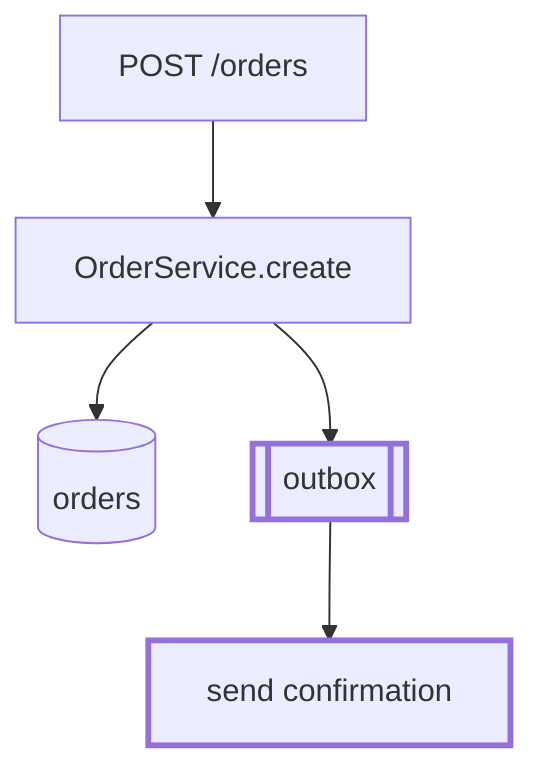

# personal-review-guide reference

## Bucket table

`scripts/review_facts.py` puts each changed path in the first bucket whose
patterns match (shell globs on the repo-relative path). Buckets are hints
for grouping and tagging, not tags. Keep this table and the script's
`BUCKETS` in step.

| Bucket | Matches |
| --- | --- |
| `generated` | lockfiles (`package-lock.json`, `pnpm-lock.yaml`, `yarn.lock`, `go.sum`, `Cargo.lock`, `poetry.lock`, `uv.lock`, `Gemfile.lock`, `Package.resolved`, `composer.lock`, `bun.lockb`), `*.min.js`, `*.min.css`, `gen/`, `generated/`, `*_pb2.py`, `*_pb2_grpc.py`, `*.pb.go`, `*.g.dart`, `vendor/`, `__snapshots__/`, `*.snap` |
| `tests` | `test/`, `tests/`, `__tests__/`, `spec/`, `*_test.go`, `test_*.py`, `*_test.py`, `*.test.[jt]s(x)`, `*.spec.[jt]s(x)`, `*Tests.swift`, `*Test.kt`, `*Tests.kt`, `*Test.java`, `conftest.py` |
| `schema` | `migrations/`, `migrate/`, `alembic/`, `*.sql`, `*.prisma`, `schema.*`, `*.avsc` |
| `api` | `*.proto`, `openapi*`, `swagger*`, `*.graphql`, `*.gql`, `*.schema.json`, `api/`, `routes/`, `handlers/`, `controllers/` |
| `config` | `Dockerfile*`, `*.tf`, `*.tfvars`, `.github/`, `k8s/`, `helm/`, `charts/`, `Makefile`, `*.mk`, `package.json`, `go.mod`, `Cargo.toml`, `pyproject.toml`, `requirements*.txt`, `*.yaml`, `*.yml`, `*.toml`, `*.ini`, `.env*`, `.claude/`, `hooks/*.json` |
| `docs` | `*.md`, `*.mdx`, `*.mdc`, `*.rst`, `docs/`, `LICENSE*`, `*.txt` |
| `orchestration` | names containing `orchestrat`, `workflow`, `pipeline`, `scheduler`, `queue`, `saga`, `dispatch`; `jobs/`, `workers/`, `worker/` |
| `source` | everything else |

The script also lists paths whose names mention a sensitive area (auth,
crypto, secrets, tokens, permissions, sessions, OAuth, JWT, credentials,
ACLs, signing, certificates, keys, login), and test files with lines
removed. Both are prompts to read, not findings.

## Review time

Read the guide (about 2 minutes), then each area at its tag:

| Tag | Changed lines per minute |
| --- | --- |
| `[study]` | 25 |
| `[check]` | 75 |
| `[skim]` | 250 |
| `[skip]` | 0 |

Add a minute per diagram pair and per rendered surface to compare. Round
to the nearest 5 minutes above 10. It's an estimate for the reader, not a
measurement; adjust for code that's dense or trivial for its size.

## Diagram recipe

A pair of blocks with the same node ids, so the difference is the only
difference. In the after diagram, give what's new or changed a thick
stroke; in the before diagram, give what goes away a dashed one. Strokes
read in both GitHub themes, fills don't. Top to bottom, under 15 nodes.

````markdown
**Before** (base `abc1234`)



**After**


````

For a `sequenceDiagram`, which has no classes, wrap the new or changed
messages in `rect` blocks in the after diagram and name them in a sentence
under it. For `stateDiagram-v2` and `erDiagram`, list added and removed
states, fields or relations under the after diagram.

When only the after side has anything to show (a new flow), draw the after
alone and say there was no before.

## Plan section: Shape of the change

```markdown
## Shape of the change

Expected tier: [study] (the `/v1/orders` response gains a field)

| Area | Tag | Change |
| --- | --- | --- |
| `api/orders.proto` | [study] | add `fulfillment` |
| `orders/service.go` | [check] | poll the carrier, new timeout path |

<before/after table or diagram pair, from the base code and the proposal>
```

Or, when a preview would need the real implementation:

```markdown
Preview skipped: the layout change only shows once the solver runs;
before/after at completion.
```

## Terminal summary

The walkthrough prints this beside the Artifact page (or the draft's
path), so the shape of the change reads without opening anything:

```text
Review tier: [study], `GET /v1/orders/{id}` gains a field
Blast radius: every orders client; additive, revert is safe
Review time: ~12 min

1. [study] api/orders.proto: new fulfillment field
2. [check] orders/service.go: fills it, new carrier timeout path
3. [check] orders/service_test.go: two cases rewritten
4. [skim]  docs/orders.md
5. [skip]  gen/, go.sum (buf, go mod tidy)

Validation: make test pass (412); make e2e not run (needs staging creds)
Draft: specs/handoffs/plan-orders-otter-review.md
```
