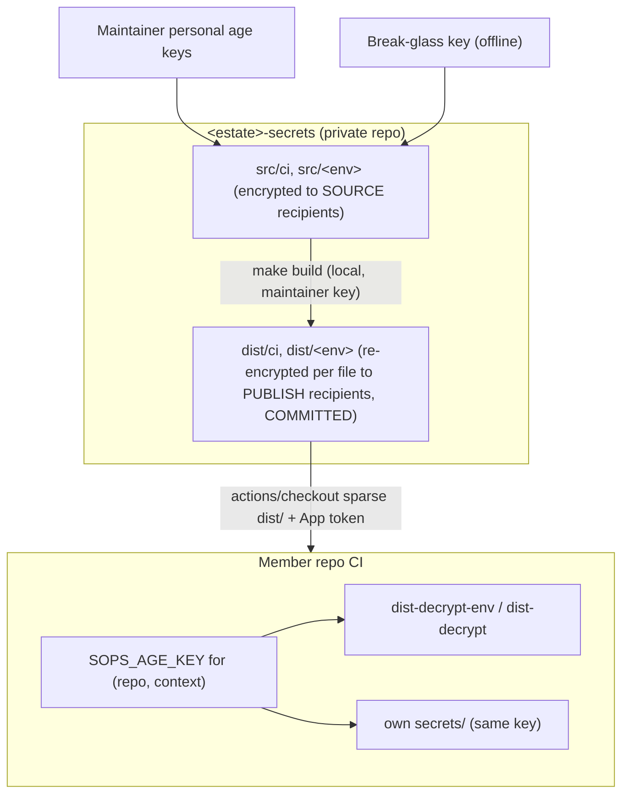

# Estate Secrets

> Placeholders: `<estate>` (e.g. `example`), `<org>` (e.g. `lolay`), `<env>`.

For values that two or more repos in an estate use. Read
[single-repo.md](single-repo.md) first: this file describes only how the
estate strategy differs. An estate is the same set of repos an estate review
covers ([codebase-review.md](../codebase-review.md#estates)): the members of a
workspace's `repos.mk`, or a list the Owner names.

Contents: [How it differs from a single repo](#how-it-differs-from-a-single-repo) · [When a value moves to the estate](#when-a-value-moves-to-the-estate) · [How it works in one picture](#how-it-works-in-one-picture) · [Consumer side](#consumer-side) · [The secrets repo](#the-secrets-repo) · [Makefile](#makefile) · [Reference implementation](#reference-implementation) · [Build and freshness](#build-and-freshness) · [Setup runbook](#setup-runbook) · [Rotation and offboarding](#rotation-and-offboarding) · [Threat model](#threat-model)

## How it differs from a single repo

The same as a single repo: [what goes in](single-repo.md#what-goes-in)
(secrets only, every value encrypted), the `.sops` suffix, the
[scopes](single-repo.md#scopes) (`ci/` and one per GitHub environment), the identities and their `SOPS_AGE_KEY` stores, environment
branch policies, [deployed services](single-repo.md#deployed-services) and
[naming](single-repo.md#naming), cleartext editing with the `.sops` suffix, and
what rotation does and doesn't undo.

| | Single repo | Estate |
|---|---|---|
| Where | `<repo>/secrets/` | A private `<org>/<estate>-secrets` repo |
| Holds | Values only this repo uses | Values two or more member repos use, and any secret a public member needs |
| Repo visibility | Private only | Any member; the secrets repo itself is private |
| Who opens a file | The scope's creation rule in `.sops.yaml` | `access.map`, per file, across repos |
| Encryption | One step: each file is encrypted straight to its readers | Two steps: `src/` is encrypted to maintainers only, and `make build` re-encrypts each file into `dist/` for its readers |
| CI keys | Minted in the repo; the private half lives only in GitHub | Minted into `keys/repos.env.sops`; `make set-keys` pushes them |
| How CI gets the files | They're in the repo's own checkout | A Secrets GitHub App token and a sparse checkout of `dist/` |
| Tooling | The repo's `secrets-*` Makefile targets | The `personal-secrets` kit |

The second encryption step exists because the estate edits each value once and
publishes it to a different set of repos per file. Maintainers edit `src/`, and
no CI key can open it.

**One key per `(repo, context)` opens both.** A member repo's `.sops.yaml` names
the public halves of the keys the estate minted for it, so the one
`SOPS_AGE_KEY` in each store opens the repo's own `secrets/` and its estate
grants. When a repo that minted its own keys joins, the estate mints new ones
for it, the repo swaps the public halves into `.sops.yaml`, and runs
updatekeys with `ROTATE=1`.

## When a value moves to the estate

A value lives in exactly one place. When a second repo needs a value that lives
in a repo's `secrets/`, move it in one change set: add it to the estate's
`src/`, grant both repos in `access.map`, run `make build`, point both repos'
CI at the estate copy, then delete it from the repo's `secrets/`. Never copy a
value into a second repo, because then a rotation has to find every copy.

A repo can use both strategies at once: its own `secrets/` for what only it uses,
and estate grants for what it shares. A repo that only uses shared values has
no `secrets/` folder.

## How it works in one picture



Two gates protect a member:

1. **Can it fetch the ciphertext at all?** A read-only **Secrets GitHub App**
   grants `contents: read` on the secrets repo so CI can check it out. This is
   per repo.
2. **What can it decrypt?** Its `SOPS_AGE_KEY`. A member may pull every file
   but opens only the ones encrypted to its key. All access control lives here.

---

## Consumer side

What each member repo wires up. Makefile target details and examples:
[makefile.md](makefile.md#estate-targets).

### Identities

The [single-repo identities](single-repo.md#identities-and-keys) are the
estate's too, with the same `__` delimiter: `<repo>__actions`,
`<repo>__env-<env>`, `<repo>__agents`, `<repo>__codespaces`,
`<repo>__dependabot`. Each is one store's `SOPS_AGE_KEY`; the
[stores table](makefile.md#github-secret-stores-by-context) says how each is
set. Provision a context only once a workflow in it needs an estate file.

> `dependabot` can't mint App tokens the normal way, so a Dependabot job that
> needs estate files must have them staged in advance rather than fetched live.

### The consumer step

The member checks out `dist/` (HEAD is always the latest) and decrypts what its
key can open. A deploy job declares its environment, so the step gets that
environment's key ([single-repo.md](single-repo.md#ci)).

**Checkout (all members):**

```yaml
- uses: actions/create-github-app-token@v1
  id: tok
  with:
    app-id: ${{ vars.SECRETS_APP_ID }}
    private-key: ${{ secrets.SECRETS_APP_PRIVATE_KEY }}
    owner: <org>
    repositories: <estate>-secrets
    permission-contents: read

- uses: actions/checkout@v4
  with:
    repository: <org>/<estate>-secrets
    token: ${{ steps.tok.outputs.token }}
    sparse-checkout: dist
    path: _secrets
    fetch-depth: 1

- uses: nhedger/setup-sops@v2   # installs the sops binary; age support is built in
```

**Decrypt (pick the narrowest target):**

```yaml
# 1. One key, one command (preferred when a single value suffices)
- name: Use required secret for one command only
  env:
    SOPS_AGE_KEY: ${{ secrets.SOPS_AGE_KEY }}
  run: SENTRY_AUTH_TOKEN="$(make -C _secrets dist-decrypt-env FILE=ci/sentry.env KEY=SENTRY_AUTH_TOKEN)" make release

# 2. Export one key to the job environment for later steps
- name: Export one required secret for later steps
  env:
    SOPS_AGE_KEY: ${{ secrets.SOPS_AGE_KEY }}
  run: make -C _secrets dist-decrypt-env KEY=SENTRY_AUTH_TOKEN FORMAT=dotenv >> "$GITHUB_ENV"

# 3. Decrypt a binary file to disk (signing material, certificates)
- name: Decrypt signing file to disk
  env:
    SOPS_AGE_KEY: ${{ secrets.SOPS_AGE_KEY }}
  run: make -C _secrets dist-decrypt FILE=ci/AuthKey_BV7QPDLS45.p8
```

**A service that reads a shared runtime value** still lists it in its own
file, `secrets/<env>/<service>.env`, with the value `@estate`. The service's
file stays the complete list of what it reads
([single-repo.md](single-repo.md#each-service-gets-only-its-own-file)). The
sync resolves each `@estate` key from the `_secrets/dist/<env>/` files the
repo's key opens, and fails if the key is in none of them, or in two with
different values.

Notes:

- **One shipped entrypoint.** `dist-decrypt-env.sh` and `dist-decrypt.sh` live in
  the secrets repo and travel with the checkout, so decrypt logic is defined once.
- **Always latest.** `actions/checkout` at HEAD of `main` gives the newest
  `dist/`. Pin `ref:` to a SHA or tag only for reproducible builds.
- **What the checkout pulls.** Cone-mode `sparse-checkout: dist` brings `dist/`
  plus root files (`Makefile`, `dist-decrypt-env.sh`, `dist-decrypt.sh`), never
  `src/`, `scripts/` or `keys/`.
- **`dist-decrypt-env`** emits dotenv to stdout only and never writes env files to
  disk. **`dist-decrypt`** writes plaintext siblings to disk only and never emits
  environment assignments.

---

## The secrets repo

### Structure

```text
<estate>-secrets/                       private repo
├─ .sops.yaml                              SOURCE recipients (maintainer + break-glass pubs) for src/ and keys/
├─ .gitignore                              track only *.sops under src/ dist/ keys/ (plaintext can't be committed)
├─ Makefile                                see makefile.md
├─ README.md                               short pointer to this standard
├─ access.map                              SOURCE OF TRUTH: groups + file -> groups/identities (logical names, no .sops)
├─ breakglass.pub                          break-glass PUBLIC key (a publish recipient on every file)
├─ dist-decrypt-env.sh                     CONSUMER entrypoint: dotenv to stdout
├─ dist-decrypt.sh                         CONSUMER entrypoint: files to disk
├─ src/                                    editable originals; only *.sops is tracked
│  ├─ ci/
│  │  ├─ apple-team.env.sops
│  │  ├─ sentry.env.sops
│  │  ├─ AuthKey_BV7QPDLS45.p8.sops
│  │  └─ apple-distribution.p12.sops
│  ├─ dev/
│  │  └─ backend.env.sops
│  └─ prod/
│     └─ backend.env.sops
├─ dist/                                   COMMITTED, re-encrypted per file to PUBLISH recipients (mirrors src/)
├─ keys/
│  └─ repos.env.sops                       SOPS-encrypted to maintainers + break-glass:
│                                          <repo>__<context>__public / __private for every member
├─ scripts/                                lib, build, crypt, keys, set-consumer-keys, check, verify
├─ .githooks/
│  └─ pre-commit                           keyless: refuse non-.sops + assert src/<f>.sops paired with dist/<f>.sops
└─ .github/workflows/
   └─ freshness.yml                        keyless CI: the same checks over the pushed range
```

The `.sops` convention and the reason for it are the
[single repo's](single-repo.md#layout). `access.map` uses the logical name (no
`.sops`); the scripts add and strip the suffix. The tracked secrets-bearing
files are exactly `.sops.yaml`, `access.map`, `breakglass.pub`, and the
`*.sops` files under `src/`, `dist/` and `keys/`. **Publish recipient lists are
never committed**: `build` computes them from `access.map` and
`keys/repos.env.sops` at encrypt time. No workflow holds a key; the kit's
`freshness.yml` is keyless.

```gitignore
# .gitignore: only *.sops is tracked under src/ dist/ keys/; plaintext siblings are ignored
/src/**
/dist/**
/keys/**
!/src/**/
!/dist/**/
!/keys/**/
!/src/**/*.sops
!/dist/**/*.sops
!/keys/**/*.sops
```

### Groups and the access matrix

Files are the coarse unit of access, under scope folders. A single repo names
a file for its one consumer. An estate file has several, so it's named for what
they share: the resource or credential (`ci/apple-team.env`), or the group of
consumers (`prod/backend.env`). Keys follow the
[single-repo rules](single-repo.md#naming) unchanged. Access is granted to
named **groups** of `repo__context` identities. A group is only a label for a
set of identities: there is **no inheritance or implied access**. Every file
lists exactly the groups (or single identities) allowed to decrypt it.

Worked example: two apps that share an Apple team, and two backend services that
share an email provider.

| file \ identity | example-ios `__actions` | example-mac `__actions` | example-api `__env-dev` | example-worker `__env-dev` | example-api `__env-prod` | example-worker `__env-prod` |
|---|:---:|:---:|:---:|:---:|:---:|:---:|
| `ci/apple-team.env` | yes | yes | | | | |
| `ci/AuthKey_BV7QPDLS45.p8` | yes | yes | | | | |
| `ci/apple-distribution.p12` | yes | yes | | | | |
| `ci/sentry.env` | yes | yes | | | yes | yes |
| `dev/backend.env` | | | yes | yes | | |
| `prod/backend.env` | | | | | yes | yes |

Each row is exactly that file's access list:

- The signing files list only `@apple-ci`. No backend identity opens them.
- `ci/sentry.env` lists `@apple-ci` and `@backend-prod`. That makes the
  backends' prod deploy jobs readers of a `ci/` file, because a job that
  declares `environment: prod` holds only its prod key.
- `prod/backend.env` lists only `@backend-prod`, and `dev/backend.env` only
  `@backend-dev`. A prod identity reads no dev file and a dev identity reads no
  prod file, because nothing is inherited.

### `access.map`: the source of truth

Define groups as sets of `repo__context` identities at the top, then list which
groups (or single identities) may decrypt each file.

```text
# --- groups: named sets of repo__context identities ---
@apple-ci     = example-ios__actions example-mac__actions
@backend-dev  = example-api__env-dev example-worker__env-dev
@backend-prod = example-api__env-prod example-worker__env-prod

# --- file : groups / identities allowed to DECRYPT it (no inheritance) ---
ci/apple-team.env:             @apple-ci
ci/AuthKey_BV7QPDLS45.p8:      @apple-ci
ci/apple-distribution.p12:     @apple-ci
ci/sentry.env:                 @apple-ci @backend-prod
dev/backend.env:               @backend-dev
prod/backend.env:              @backend-prod
```

At build time, `build.sh` expands each `@group`, resolves public keys from
`keys/repos.env.sops`, adds break-glass, and re-encrypts `src/<file>.sops` to
`dist/<file>.sops`.

### Two keyrings

- **SOURCE recipients**: maintainer personal keys and break-glass. This list
  **is committed** in `.sops.yaml`. Only these keys can read `src/` and
  `keys/repos.env.sops`. Re-encryption into `dist/` happens **locally** with a
  maintainer key, so no machine key ever reads source.
- **PUBLISH recipients** (per file): the member `(repo, context)` keys allowed
  to decrypt that file, plus break-glass. `build` resolves them at encrypt time;
  they're never committed, and they can't open `src/`.

```yaml
# .sops.yaml: committed SOURCE recipients (maintainers + break-glass)
creation_rules:
  - path_regex: ^(src|keys)/.*
    age: >-
      age1alice...,
      age1bob...,
      age1breakglass...      # same key as breakglass.pub
```

Adding or removing a maintainer: edit the `age:` list in `.sops.yaml`, then
`sops updatekeys src/**/*.sops keys/repos.env.sops`.

### `keys/repos.env.sops`: the member key registry

One SOPS-encrypted dotenv (recipients: maintainers and break-glass) holding
every member keypair:

```dotenv
example-ios__actions__public=age1...
example-ios__actions__private=AGE-SECRET-KEY-1...
example-api__env-prod__public=age1...
example-api__env-prod__private=AGE-SECRET-KEY-1...
```

Only maintainer-local targets (`make build`, `make set-keys`, `make verify`)
decrypt this file. **The custody cost:** this is the one difference from a
single repo that adds risk. It holds every member's *private* key, so a
maintainer key compromise exposes every member context. The registry exists so
`set-keys` can re-push and `verify` can test every grant and denial with real
keys.

### Binary files (`.p8`, `.p12`, certificates, provisioning profiles)

Binary files use SOPS's **binary** type, with the same recipients and access
matrix:

```bash
cp /path/to/AuthKey_BV7QPDLS45.p8 src/ci/AuthKey_BV7QPDLS45.p8
make src-encrypt FILE=ci/AuthKey_BV7QPDLS45.p8
make build
```

On the member, `make dist-decrypt FILE=ci/AuthKey_BV7QPDLS45.p8` writes the
plaintext next to its `.sops` file (`_secrets/dist/ci/AuthKey_BV7QPDLS45.p8`).

> Size: SOPS binary inflates by about a third (base64). That's fine for keys and
> certificates, which are a few KB.

---

## Makefile

Full target contract, arguments and GitHub Actions examples:
[makefile.md](makefile.md#estate-targets).

**What runs where:** targets that read source secrets (`src-decrypt`,
`src-encrypt`, `build`, `set-keys`, `mint`, `rotate`) run on a maintainer's
machine and need a source key. `dist-decrypt-env` and `dist-decrypt` run on
members and need only that member's `SOPS_AGE_KEY`. Nothing needs a source key
in CI.

---

## Reference implementation

The scripts live as a tested kit in the `personal-secrets` skill:
[`templates/secrets-repo/`](../../../personal-secrets/templates/secrets-repo/),
with an end-to-end test in
[`tests/test-kit.sh`](../../../personal-secrets/tests/test-kit.sh). Copy the
kit to start a new secrets repo.

| File | Role |
| --- | --- |
| `dist-decrypt-env.sh` | Member: dotenv secrets to stdout, never to disk |
| `dist-decrypt.sh` | Member: decrypt files to owner-only plaintext siblings; no env output |
| `scripts/build.sh` | Resolve publish recipients (transient) and re-encrypt `src/` to `dist/`; delete `dist/` files no longer mapped |
| `scripts/crypt.sh` | `src/` to and from `.sops` siblings, safe and idempotent |
| `scripts/keys.sh` | `mint`, `rotate`, `retire` member keypairs in `keys/repos.env.sops`, with no plaintext registry on disk |
| `scripts/set-consumer-keys.sh` | Push `SOPS_AGE_KEY` to each `(repo, context)` store; key goes to `gh` on stdin |
| `scripts/check.sh` | Keyless checks shared by the pre-commit hook and CI |
| `scripts/verify.sh` | With each member key: granted identities decrypt, others don't, and `dist/` matches `src/` |

**Contexts** are the GitHub secret stores: `actions`, `agents`, `codespaces`
and `dependabot` map to `gh secret set --app <context>`, and `env-<name>` maps
to `gh secret set --env <name>`. An environment name can't contain `__`, the
identity delimiter.

Two constraints the implementation has to respect:

- **Encrypting `dist/` must bypass `.sops.yaml`.** Its only creation rule
  covers `src/` and `keys/`, so `sops -e` on stdin fails with "no matching
  creation rules found", even with `SOPS_AGE_RECIPIENTS` or `--age` set.
  `build.sh` passes `--config /dev/null` with `--age <recipients>`, and
  writes through a temp file so a failure never leaves an empty `dist/`
  file to commit.
- **macOS ships bash 3.2**, so the scripts avoid associative arrays and
  other bash 4 features.

---

## Build and freshness

`dist/` is committed, so it has to stay in sync with `src/`. Two keyless guards:

1. **Local pre-commit hook**: refuse non-`.sops` under `src/`, `dist/`, `keys/`;
   require every changed `src/<file>.sops` to ship with a matching
   `dist/<file>.sops`, and an `access.map` change to ship with a rebuilt `dist/`.
2. **Keyless CI check** (`freshness.yml`): the same rules over the pushed range.

A maintainer's `make verify` goes further. It decrypts every `dist/` file with
every member key, so it catches a stale `dist/` and any over-sharing the keyless
checks can't see.

---

## Setup runbook

One time per estate:

1. Create private repo `<org>/<estate>-secrets`. Protect `main`; CODEOWNERS on
   `src/`, `access.map`, `keys/`, `.githooks/`.
2. Generate the break-glass key offline; put its public key in `breakglass.pub`
   and `.sops.yaml`.
3. Add maintainer public keys to `.sops.yaml`.
4. Register a read-only Secrets GitHub App (`contents: read`); install it on the
   secrets repo and the members. Distribute `SECRETS_APP_ID` and
   `SECRETS_APP_PRIVATE_KEY`.
5. Copy the kit, then run `make init` locally.
6. `make mint REPO=<repo> CONTEXT=actions` (and other contexts as needed); edit
   `access.map`.
7. Move each shared value in ([When a value moves](#when-a-value-moves-to-the-estate)):
   plaintext into `src/<scope>/`, `make src-encrypt`, `make build`, commit `*.sops`.
8. `make set-keys` to push `SOPS_AGE_KEY` to each store; each member swaps the
   new public keys into its own `secrets/.sops.yaml`.
9. Wire members with the [consumer step](#the-consumer-step).

---

## Rotation and offboarding

- **Add a member key:** `make mint REPO=.. CONTEXT=..` (refuses if one exists).
- **Rotate a member key:** `make rotate`, then `build`, `verify`, commit, then
  `CONFIRM_SET_KEYS=1 make set-keys` with the Owner's go-ahead. If the member
  has its own `secrets/`, it swaps the public key there and runs updatekeys
  with `ROTATE=1`.
- **Remove a member:** delete it from `access.map`, `make build`,
  `make retire REPO=.. CONTEXT=..`, delete the repo's `SOPS_AGE_KEY`.
- **Rotate a maintainer:** update `.sops.yaml`, `sops updatekeys`.
- **A leaked value:** revoke it upstream, and treat every committed ciphertext
  version as compromised. As in a single repo, `git revert` fixes nothing.

---

## Threat model

What a single repo's [threat model](single-repo.md#threat-model) says holds per
file here, plus:

- **`src/`** is readable only by maintainers and break-glass. No CI key can read
  it; re-encryption is local.
- **`dist/`** is readable by each file's mapped member keys and break-glass. The
  App token only downloads ciphertext.
- **`keys/repos.env.sops`** holds every member's private key, encrypted to
  maintainer keys. A maintainer key compromise exposes every member context.
- **A member key leak** opens only the files that key is a recipient of,
  including those files' history. `make rotate` stops future access; rotate the
  values upstream if the private key may have leaked.
- **A Secrets App key leak** downloads ciphertext the attacker can't decrypt.
- **Break-glass** opens everything; offline only.
