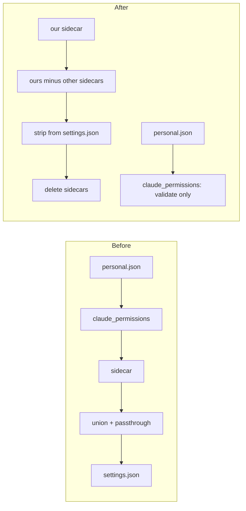

Stops the local allowlist installer from writing Claude Code's permission rules into each config dir's `settings.json`, now that the same rules reach every Claude Code surface as org managed settings rendered from `agents/allowlists/personal.json` (GaryRudolph/public#100). On a machine an earlier version installed, `make install` (and `make uninstall`) takes this org's entries back out, keeps the user's own, and deletes the sidecars. m3 of the allowlist work, r1.f1, part of GaryRudolph/public#45.

**After merge:** the Owner runs `make -C agents install` on the Mac and checks `~/.claude/settings.json` (and each other dir in `CLAUDE_CONFIG_DIRS`): only their own rules left, or no file if it held only ours, no `.settings.personal-managed.json` beside it, and `/permissions` in a session still lists the rules, from managed settings. Runbook m3.s6 has the steps.

**Shared lib:** `agents/lib/` is shared byte for byte with the other bok. Porting this there would clear that org's Claude rules from its config dirs, so the port waits until that org's managed settings are live.

## Review guide

Review tier: [study] [security], because install now edits or deletes the user's `settings.json` and drops deny rules from it.
Blast radius: every Claude config dir on a machine that ran an earlier install; a backup of each changed file lands in `.history/`, and the managed settings carry the same allows and denies.
Review time: ~20 min

1. [study] [security] [`agents/lib/allowlists.sh`](https://github.com/GaryRudolph/public/compare/main...claude/awesome-bardeen-qugb3n#diff-4e5964bcd418ec0b78ed29d961f19d9e5277a6784e224c5faabe9090e9db6d9e): `claude` kind gone; new "Claude Code: clear what earlier versions wrote" section (`claude_strip`, `clear_claude_dir`) wired into install, dry-run, uninstall, status, diff, clean; restore drops `settings.json`
2. [check] [`agents/lib/allowlists-test.sh`](https://github.com/GaryRudolph/public/compare/main...claude/awesome-bardeen-qugb3n#diff-6173c3c7684e5cbe52650c479a0c7f4335af0fcccbe2523e982cd5ce4a366545): T46-T50 upgrade tests; T31-T45 moved from `settings.json` to `cli-config.json` (same sidecar code path) or to the `claude_permissions` render
3. [check] [`agents/tests/test-claude-dirs.sh`](https://github.com/GaryRudolph/public/compare/main...claude/awesome-bardeen-qugb3n#diff-393ebd3ac9b24c508b7ed5cf911bb77b5e9c60ac133cf249cf1dda406ef285e3): leftovers seeded through the Makefile and cleared
4. [skim] [`agents/runbook.md`](https://github.com/GaryRudolph/public/compare/main...claude/awesome-bardeen-qugb3n#diff-397a2ef4aea9aaf65ae3439f911db4dc92d3006528b0c0477a05f8953b941d30) (new m3.s6, Verify is now s7), [`agents/README.md`](https://github.com/GaryRudolph/public/compare/main...claude/awesome-bardeen-qugb3n#diff-80ec9f41ff856af706ce4d5c9108b82e563d1c76257e4260403dd81ee7b5efc6), [`agents/allowlists/README.md`](https://github.com/GaryRudolph/public/compare/main...claude/awesome-bardeen-qugb3n#diff-1b44a51721715fc3d873af0ac12437385ef8ea146f1abd0fb14de5e6bed45118), [`agents/org/README.md`](https://github.com/GaryRudolph/public/compare/main...claude/awesome-bardeen-qugb3n#diff-67ce806629d77995ba63a2c66b7e8b7d001021f2ea021432079463c0d1e8d7a1), [`agents/Makefile`](https://github.com/GaryRudolph/public/compare/main...claude/awesome-bardeen-qugb3n#diff-f636515ed16c6c062d2e31157b8ff5e38dd1fb03ce19f1dcc0cf5c4441b9d4ee) (comments only), [`specs/agent-distribution.md`](https://github.com/GaryRudolph/public/compare/main...claude/awesome-bardeen-qugb3n#diff-340718d9c36f18896bb2c6aa8f1b20c862e98cd92a61d2aa6661abd426728ed7)

## Validation

- `make -C agents validate test`: pass (allowlists T01-T50, test-claude-dirs, roundtrip, org render check, every other suite)
- Manual: a sandbox HOME rendered by the installer at `6583d54` with the real `personal.json`, then this branch's install: 445 entries removed, a promoted and an unpromoted user entry kept, `model`/`defaultMode` kept in order, sidecars gone, second install silent
- On the Owner's Mac: not run, see "After merge"

## Rollback

Revert the squash commit. That doesn't restore the removed entries: `make restore-allowlists` no longer takes `settings.json`, so copy `<dir>/.history/settings.json.1` back by hand. With managed settings live nothing is lost meanwhile.

[study] What install does to a Claude config dir

| | Before | After |
| --- | --- | --- |
| `settings.json` | Re-rendered: union of every org's sidecar, user-managed, passthrough | Edited in place only if our sidecar is there: our entries out, the rest untouched, order kept |
| Entry also in another org's or user-managed sidecar | Kept | Kept |
| `.settings.personal-managed.json` | Written | Deleted |
| User-managed, passthrough sidecars | Written | Deleted once no other org's sidecar is left; kept for its installer otherwise |
| File left `{}` | n/a | Removed (backup kept) |
| Dir with no sidecar of ours | Rendered | Not read or written |

The meta still has to render as `claude_permissions` before anything is written, so a bad MCP entry the Cursor forms would pass through is refused here as before (T41b).

[check] Tests

- T46: an old render with a stale entry, a promoted and an unpromoted user entry, passthrough keys. Dry-run, status and diff preview it without writing; install leaves only the user's; second install a no-op.
- T47: a file of only ours is removed; uninstall clears too; `REMOVE_HISTORY=yes` takes the backup.
- T48: a peer org still rendering keeps its entries and the shared sidecars; the result equals the peer installer's own render.
- T49: several `CLAUDE_CONFIG_DIRS` plus the WSL dir; a dir with no sidecar of ours is byte-identical.
- T50: clean covers the Claude `.history/`; restore of `settings.json` exits 2.
- They caught `gemini_dirs` returning 1 under `set -e`, which silently skipped the Claude dirs in clean and the uninstall prompt; fixed.

Decisions

- Subtract in place rather than re-render: the user's file keeps its order and anything Claude Code wrote since, and no other org's render is reshaped.
- Keep `claude_permissions` in `validate_meta`: it was the only check on MCP entry shape.
- Drop `settings.json` from restore: a pre-upgrade backup would bring our entries back with no sidecar to clear them.
- Follow-up, not here: the allowlist scout still counts Claude global coverage from each dir's `settings.json`, which no longer holds the org rules.

Claude-Session: https://claude.ai/code/session_01BNKwNaxo58LmaHdk1Xv116

Assisted-by: Claude Code
