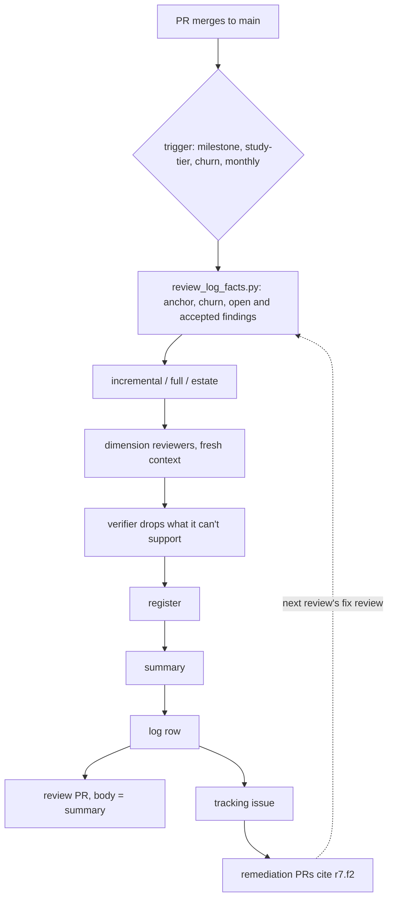

Adds a review of `main`, separate from the per-PR review: incremental (every line since the last logged review, via `/code-review` on the commit range), full (architecture, contracts, boundaries, hotspots) and estate (architecture and duplicated code across repos that coordinate, with or without a workspace). Each review writes a findings register and a PR-shaped summary to `specs/reviews/` and logs its commit range so the next incremental knows where to start. The review then lands as its own PR plus a tracking issue, and fixes are separate PRs. When a milestone lands on `main`, the session that starts the next one reviews it before planning. Design and sources: `specs/codebase-review.md`.

## Review guide

Review tier: [study], because it adds a standard every agent session loads and a gate between milestones.
Blast radius: every session's core rules and milestone handoffs. Nothing runs on its own; a revert is safe.
Review time: ~25 min

1. [study] `standards/codebase-review.md`: kinds, triggers, anchors, record, findings, outputs, estates
2. [study] `personal-codebase-review/reference.md` "Log" and "Register": the formats the script parses
3. [study] `standards/plan-execution.md` "Review gate" (between plans, never a worker step), and the `core.md` bullet
4. [check] `scripts/review_log_facts.py` and `tests/test-codebase-review.sh`
5. [check] `personal-codebase-review/SKILL.md`; the gate notes in `personal-plan-model-tiers`, `personal-plan-orchestrate/kickoff.md`, `personal-handoff`
6. [skim] `specs/codebase-review.md`, `review.md` and `documentation.md` one-liners, indexes, `plugins/README.md`, `agents/Makefile`
7. [skip] `cursor/rules/personal-core.mdc` (`make -C agents cursor-core-rule`); `specs/handoffs/` plan and this draft, removed before merge

## Validation

- `make -C agents validate test`: pass, including the new `test-codebase-review` (71 checks) and the session-start size test (core part 3 is 8,760 of 9,000 characters)
- `review_log_facts.py` on this repo: no log, next `r1`, hotspots listed
- A real review with the skill: not run; that's the first follow-up card (`r1` of this repo)
- Fresh-context review of this branch: 11 findings, all fixed (see Decisions)

## Rollback

Revert the squash commit. No repo has a `specs/reviews/` yet, and the gate only appears in plans grouped after merge.

[study] What changes for an agent

| | Before | After |
| --- | --- | --- |
| Review of `main` | none | incremental, full, estate; logged in `specs/reviews/` |
| Anchor for "since last review" | none | last `incremental` or `full` row's `<to>`, on the default branch |
| Milestone lands | handoff, next milestone | handoff says `Review: pending`; the next session reviews `main` before planning, or a card `1: Review m{N} on main` runs first |
| One-PR plan merges | Completion summary | same, plus the post-merge review under Follow-ups |
| Pre-PR review | review guide plus `/code-review` | unchanged; may be called `interim`, never logged |

[check] The facts script

Read-only; fetches only the default branch (unshallowing a shallow clone), and reads the log and registers from it, not from the checked-out branch. Reads the log table (`| r{N} |` rows, 8 cells), registers (`### r{N}.f{K} - title` with `- Field: value` lines), an estate register's `- Members:` line, `repos.mk` through `make` with a regex fallback, and `--members` globs against sibling folders (or the workspace) and, with `gh`, the owner's repos over REST, printing the error when `gh` can't list them. Unmerged `review/r*` branches reserve their numbers. Bucket table is imported from `personal-review-guide/scripts/review_facts.py`, not copied. Prints no verdict on whether a review is due.

Decisions

- Anchors on the default branch only: squash merges erase branch SHAs.
- Full reviews read structure plus hotspots, not every line; estate reviews read architecture and duplication only. Contract breakage between repos is left to CI gates.
- One model, the strongest, in a fresh context: the cross-model study found no gain on code.
- Fix PRs don't edit `specs/reviews/`; the next review's fix review records outcomes.
- The monthly schedule is described, not built.
- `personal-plan-tag-tiers` is untouched: it only tags.
- The fresh-context review's two serious findings changed the design: the script read the log from the checked-out branch (now from the default branch), and the milestone gate was a plan step a worker can't run (now a step between plans, in the session that starts the next milestone). The other nine (shallow clones, private and unlistable repos, write-back of statuses, loose status values, the PR guard's heading, workspace members, unmerged review branches, submodules) are fixed with tests.

Assisted-by: Claude Code
