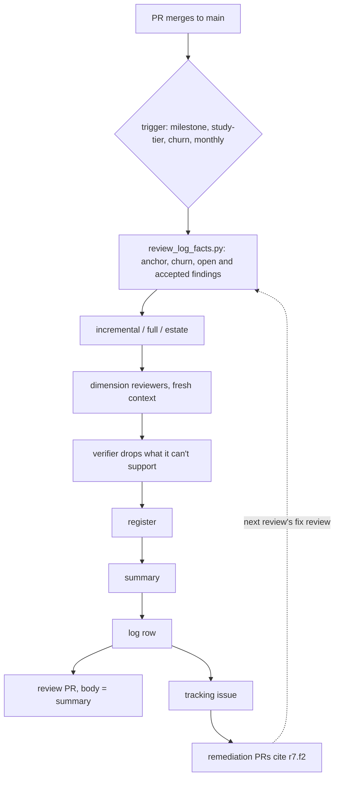

Adds a review of `main`, separate from the per-PR review: incremental (every line since the last logged review, via `/code-review` on the commit range), full (architecture, contracts, boundaries, hotspots) and estate (architecture and duplicated code across repos that coordinate, with or without a workspace). Each review writes a findings register and a PR-shaped summary to `specs/reviews/` and logs its commit range so the next incremental knows where to start. The review then lands as its own PR plus a tracking issue, and fixes are separate PRs. Milestones that land on `main` get a review gate. Design and sources: `specs/codebase-review.md`.

## Review guide

Review tier: [study], because it adds a standard every agent session loads and changes how tiered plans are grouped.
Blast radius: every session's core rules and every new tiered plan (a gate step after multi-PR milestones). Nothing runs on its own; a revert is safe.
Review time: ~25 min

1. [study] `standards/codebase-review.md`: kinds, triggers, anchors, record, findings, outputs, estates
2. [study] `personal-codebase-review/reference.md` "Log" and "Register": the formats the script parses
3. [study] `standards/plan-execution.md` "Review gate", and the `core.md` bullet
4. [check] `scripts/review_log_facts.py` and `tests/test-codebase-review.sh`
5. [check] `personal-codebase-review/SKILL.md`, the gate text in `personal-plan-model-tiers` and `personal-plan-orchestrate/kickoff.md`
6. [skim] `specs/codebase-review.md`, `review.md` and `documentation.md` one-liners, indexes, `plugins/README.md`, `agents/Makefile`
7. [skip] `cursor/rules/personal-core.mdc` (`make -C agents cursor-core-rule`); `specs/handoffs/` plan and this draft, removed before merge

## Validation

- `make -C agents validate test`: pass, including the new `test-codebase-review` (47 checks) and the session-start size test (core part 3 is 8,752 of 9,000 characters)
- `review_log_facts.py` on this repo: no log, next `r1`, hotspots listed
- A real review with the skill: not run; that's the first follow-up card (`r1` of this repo)
- Fresh-context review of this branch: see Decisions

## Rollback

Revert the squash commit. No repo has a `specs/reviews/` yet, and the gate only appears in plans grouped after merge.

[study] What changes for an agent

| | Before | After |
| --- | --- | --- |
| Review of `main` | none | incremental, full, estate; logged in `specs/reviews/` |
| Anchor for "since last review" | none | last `incremental` or `full` row's `<to>`, on the default branch |
| Multi-PR plan | milestones run back to back | `m{N+1}.s1 [deep] Review m{N} on main` after each merge |
| One-PR plan | Completion summary | same, plus a post-merge review under Follow-ups |
| Pre-PR review | review guide plus `/code-review` | unchanged; may be called `interim`, never logged |

[check] The facts script

Read-only; fetches only the default branch. Reads the log table (`| r{N} |` rows, 8 cells), registers (`### r{N}.f{K} - title` with `- Field: value` lines), an estate register's `- Members:` line, `repos.mk` through `make` with a regex fallback, and `--members` globs against sibling folders and, with `gh`, `users/<owner>/repos` over REST. Bucket table is imported from `personal-review-guide/scripts/review_facts.py`, not copied. Prints no verdict on whether a review is due.

Decisions

- Anchors on the default branch only: squash merges erase branch SHAs.
- Full reviews read structure plus hotspots, not every line; estate reviews read architecture and duplication only. Contract breakage between repos is left to CI gates.
- One model, the strongest, in a fresh context: the cross-model study found no gain on code.
- Fix PRs don't edit `specs/reviews/`; the next review's fix review records outcomes.
- The monthly schedule is described, not built.
- `personal-plan-tag-tiers` is untouched: it only tags, and the gate is a grouping decision.

Assisted-by: Claude Code
