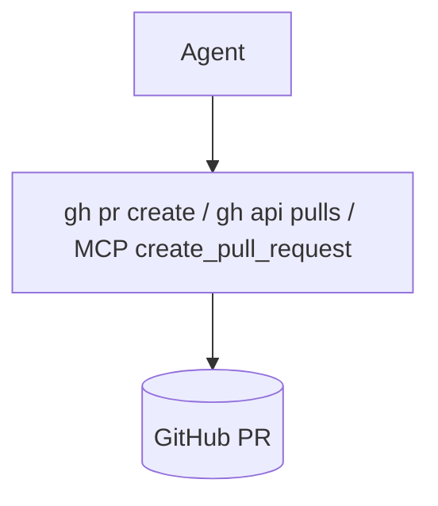
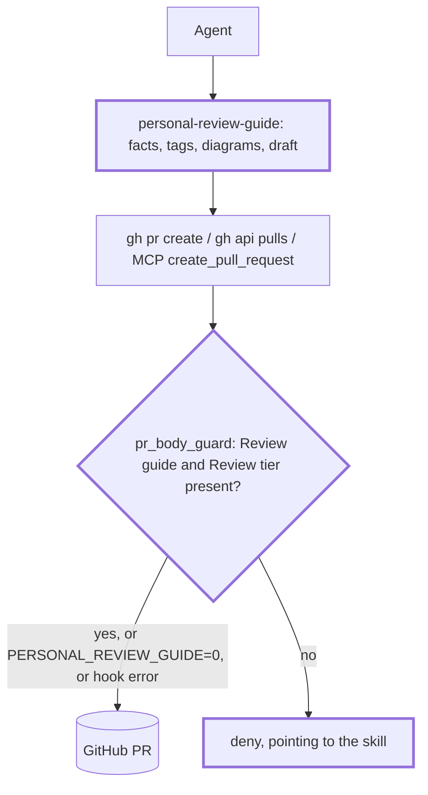

Agents now hand over a review guide instead of a bare diff. Each area of a change is tagged `[study]`, `[check]`, `[skim]` or `[skip]`, and the PR's tier is the highest tag. The PR description is laid out to be understood in about 2 minutes on a phone, with each tier in its own collapsible block. Before/after diagrams are drawn from the base commit's code. A repo can add its own before/after renders through a `## Review surfaces` section in AGENTS.md. Plan: `specs/handoffs/plan-review-guides-heron.md`.

## Review guide

Review tier: [study], because a new hook can deny PR creation in every repo that loads the personal plugin, and `core.md` changes every session.
Blast radius: every agent session with the plugin, and PR creation in every repo whose PR body lacks the guide (nowline and the Agerpoint repos included, until they adopt it). `PERSONAL_REVIEW_GUIDE=0` turns the hook off. Nothing is persisted, so a revert is safe.
Review time: ~20 min. That's over the 400-line guideline (1,527 added); m3 (hook and baseline) could be split into its own PR.

1. [study] `pr_body_guard.py` and `claude-hooks.json`: what it denies, and that it fails open
2. [study] `core.md` bullet and `git.md` "PR Body": always-on rule, new body skeleton
3. [check] `standards/review.md`: the standard, against the plan we agreed
4. [check] `personal-review-guide/SKILL.md` and `reference.md`: the procedure
5. [check] `personal-repo-baseline`: PR template item, facts, template
6. [skim] `review_facts.py`, the tests, and doc index rows
7. [skip] `personal-core.mdc` (`make -C agents cursor-core-rule`), and `specs/handoffs/` (removed before merge)

## Validation

- `make -C agents validate test`: pass, including the new review-guide tests (facts fixtures, 27 hook cases, hook registration) and the repo-baseline PR template cases
- `review_facts.py` on `lolay/nowline`: finds "Visual changes" and its PR template without a guide
- The hook in a live Claude Code session: not run, because this session loads the published plugin, not this branch
- Mermaid in the GitHub mobile app: not run. Check it on this PR

## Rollback

Revert the squash commit. A repo that took the baseline's PR template keeps it, which is harmless.

[study] PR creation, before and after

**Before** (base `ba74a02`)

**After**

| Path | Checked | Not checked |
| --- | --- | --- |
| `gh pr create` | `--body`, heredoc, `--body-file`/`-F`; `--fill` denied | `--web` |
| `gh api .../pulls` | POST or fields, `-F body=@f`, `--input f` | GET, PATCH, `/pulls/N/...` |
| MCP | any `mcp__*__create_pull_request` | `update_pull_request` |

`core.md` gains one Workflow bullet: tag areas, preview at plan time when cheap, walk through before asking to open a PR, and make the PR description the guide. `git.md` "PR Body" swaps Summary/Changes/Test Plan for the review guide skeleton. The trailer rules are unchanged.

[check] Standard, skill and baseline

- `review.md` covers the tiers and their checklists, the PR tier, blast radius, the 2-minute budget, the layout, evidence, diagrams, the preview gate (`if-cheap`, `required`, `report-only`), review surfaces, and the `-review.md` draft.
- The skill has three modes: plan, walkthrough and pr. It reads the code at the merge-base and at head, and the draft is regenerated on each run.
- The baseline adds a template for repos with no PR template. For an existing template it proposes a hand edit and never replaces it. It also suggests a `REVIEW.md` line for Claude Code Review.

[skim] and [skip]

- [skim] `review_facts.py`: base discovery, a path-bucket table (mirrored in reference.md), test lines removed, sensitive path names, review surfaces, PR template. No verdicts.
- [skim] Tests; rows in `plugins/README.md`, `standards/README.md`, `personal-standards/SKILL.md`, `runbook.md`; the `personal-pr` row in `specs/agent-distribution.md`.
- [skip] `personal-core.mdc` is regenerated by `make -C agents cursor-core-rule`.

Decisions

- The PR description holds everything, so it reads on a phone and lands on `main`; no sticky comment.
- The PR's tier is the highest tag (no separate low/medium/high).
- The plan-time preview is shown only when cheap. Otherwise it's skipped with a reason, and the before/after comes at completion.
- The hook checks presence only and fails open. `curl` to the API isn't covered.
- The facts script is Python, not the planned `.sh`: parsing AGENTS.md sections and the numstat output is simpler there.
- nowline's adoption is a separate PR, queued as a task.

https://claude.ai/code/session_011UbsxC34L1V3Z4mZf2TvZG

Assisted-by: Claude Code
