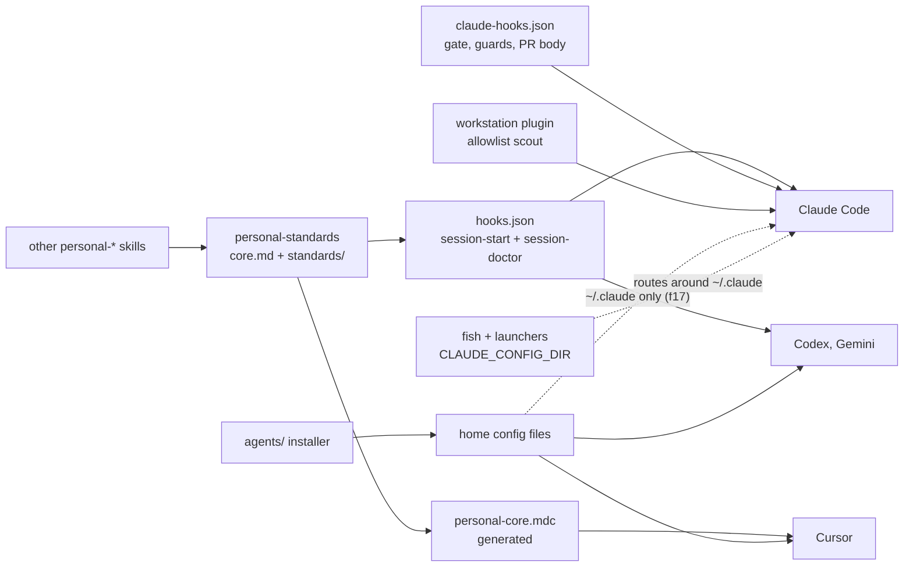

Full review of `main` at fe5a3fe (172 commits, 264 files, about 51,600 lines), the repo's first. Eight dimension reviewers and a verifier, Opus at xhigh, floor medium. Register: `2026-11-04-r1-full-findings.md`.

## Review guide

Review tier: [skim], records only; the decisions below are the reading.
Verdict: 7 high, 19 medium; 6 decisions for you. The allowlist installer and the guards around agent commands carry most of it.
Review time: ~8 min

## Decisions for you

1. **r1.f18 No CI.** Now: `make -C agents test` runs only when an agent remembers, and the guards fail open. Proposed: a required `test.yml` on Ubuntu with sops and age, plus a macOS job. Options: CI (recommended), or local-only written into `AGENTS.md`.
2. **r1.f9 MCP wildcards.** Now: `slack:*`, `notion:*`, `googledocs:*`, `firebase:*` and three more approve writes with no prompt. Proposed: allow read and search tools by name, prompt for writes. Options: by name (recommended), wildcards only for read-only servers, or accept.
3. **r1.f10 Doctor provenance.** Now: a checkout whose `origin` names a trusted owner runs `make doctor` before folder trust, fork PRs included. Proposed: approval keyed on path and the doctor file's hash. Options: hash approval (recommended), skip when `HEAD` isn't on the default branch, or accept.
4. **r1.f17 Config dirs.** Now: the installer writes `~/.claude`; your `claude` and launchers run from `~/.claude-lolay` and `~/.claude-agerpoint`. Proposed: a `CLAUDE_CONFIG_DIRS` list. Options: list (recommended), one-dir override, or document the gap.
5. **r1.f22 Doctor and floors.** Now: no `doctor`, Python floor declared 3.8, really 3.9 and 3.12. Proposed: `doctor` plus a root `triage.yaml`. Options: add (recommended), or document the exemption.
6. **r1.f16 Cost guard.** Now: editing the Cost total or the Token log moves the trip point without `gate-guard`. Proposed: gate on the computed limit. Options: gate the limit (recommended), or freeze the total at kickoff.

## Fix now

Installer order: f11, then f1 with f4. Each `agents/lib` fix is ported to the bok.

- r1.f1 high: shell allow and deny reach Claude Code and Cursor CLI as bare strings, so none apply
- r1.f11 high: removing an allowlist entry never removes it from the live file
- r1.f12 high: a malformed `settings.json` is replaced with 0 bytes, exit 0
- r1.f4 high: `op read`, `op run`, `curl -G`, `git log --output` are auto-approved
- r1.f3 high: session doctor trusts any host whose path names a trusted owner
- r1.f5 high: secrets kit's `$GITHUB_ENV` export prints secrets in job logs
- r1.f6 high: allowlist scout writes `Shell(make:*)` for an approved `make test`
- r1.f2 medium: install drops `permissions.ask`, `defaultMode` and the rest
- r1.f7 medium: Cursor denylist hook passes `pytest && rm -rf ~`, and is untested
- r1.f8 medium: worker and reviewer guards miss `if`, `for`, `{ }`, `timeout`, `bash -c`
- r1.f13 medium: reinstall after uninstall aborts
- r1.f14 medium: scout ignores make prerequisites and `$(MAKE)` calls
- r1.f15 medium: `release_facts.py` finds nothing from a subdirectory
- r1.f19 medium: keyless secrets guard tests skip without sops
- r1.f20 medium: `repo-facts.sh` needs Python 3.12
- r1.f21 medium: workflow templates pin Node 20 actions, in five places
- r1.f23 medium: `review_facts.py` misses proxy and alias origins
- r1.f24 medium: `secrets-facts.sh` prints a token in origin's URL
- r1.f25 medium: documentation.md's strikethrough breaks the plan parser
- r1.f26 medium: a runner's next-wave session starts without the plan

## Architecture

The plugins are self-contained, every cross-skill reference stays inside `personal`, and there are no cycles. The weak seam is the installer's side: what it renders for Claude Code and Cursor CLI isn't read (f1, f17).

## Rules changed

- Proposed, `AGENTS.md`: "A script that grants or denies commands (allowlist renderers, guards, hooks) has a behavior test that runs the real script on hostile input: compound commands, wrappers, and the form each harness reads. No stubs." Six findings in this review are that class: r1.f1, f6, f7, f8, f12, f14.
- Proposed, a test: run the scout's classifier over `agents/allowlists/personal.json` and fail on any entry in Remote Write, Sensitive or Destructive (r1.f4, f6, f14).

Details by dimension

Below the medium floor, recorded here and not tracked:

- **contracts**: `session-start.sh:12` detects Codex by `PLUGIN_ROOT` while `hooks.json` builds the path from `CLAUDE_PLUGIN_ROOT`; `personal.json` `read` and `write` sections are never rendered; session doctor has no overall deadline (8 parallel at 30 s against a 60 s hook timeout); `bump_version.py` always writes `## [vX.Y.Z]` and doesn't manage `[tool.poetry]` versions `release_facts.py` reports.
- **security**: `pr_body_guard.py` hangs on `--body-file /dev/zero` until its timeout, then allows; `enforce-denylist.sh` allows when jq fails though wired fail-closed; `kubectl get secrets -A -o yaml` is auto-approved; WebFetch allows `*.readthedocs.io` and `*.gitlab.com`; `setup/claude-cloud` downloads protoc and firebase unchecksummed.
- **hotspots**: `blocks.sh:448` uninstall drops a trailing blank line; `blocks.sh:291` reports the Xcode Codex file under Cursor; allowlists JSON `status` and `diff` compare sidecars, not the meta; `orchestrate_gate.py:507` doesn't check WAIVED lines on a session's first launch; `dotfiles/zshrc:6-7` tests `/etc/sshrc` and sources `/etc/zshrc`.
- **tests**: `session-start.sh` Gemini, Codex and silent paths untested; `local-marketplace.sh`, `handoff-facts.sh`, `audit.sh`, `latest_versions.py` untested; `.PHONY` omits `test-review-guide`; `make -j test` would race on `agents/build`; `plan-segment-test.mjs` fakes the Workflow API unchecked.
- **dependencies**: `audit.sh:125-137` empty array under `set -u` on bash 3.2; Claude Code floors disagree (2.1.224, 2.1.273, 2.1.292); the secrets repo `doctor` checks presence only; `--output-sync` needs make 4.0; `bin/android` calls `timeout`.
- **duplication**: helper copies across four `agents/lib` files (wording drift only); default branch found four ways; layout detection differs from `audit.sh` despite "same order"; `cursor-core-rule.py` rewrites the rule on any argument but `--check`; small dead code in `scan.py` and `extensions-test.sh`.
- **architecture**: doc counts stale (hook runs five times, not three; two plan agents, not five; twelve skills, not ten); `manifests-check.py` checks `bin/` but not `../` or symlinks; Cursor may import the Claude manifest, worth checking on first install.
- **docs**: interim review removal timing differs between the skill and the standard; three skills say to run `scripts/...` "in the target repo" though the script is in the skill; commit subjects capitalized in plan-execution examples; orchestrate's completion asks to open a PR without the walkthrough; `documentation.md:56` allows only `specs/README.md` as an ALL_CAPS name in `specs/`, which `specs/reviews/README.md` contradicts.

Covered and fine: plugin self-containment, manifests and marketplaces in agreement, the generated Cursor rule in sync, session-start parts under the cap, the review, plan and release formats matching their parsers, the PR body guard matching every template, `orchestrate_gate.py` failing closed, installer `rm -rf` guarded, bash 3.2 compatibility, GNU and BSD tool use. `make -C agents test` passed with the secrets kit skipped. Not checkable: the Agerpoint bok's copy of `agents/lib`, and live Codex, Cursor and Gemini behavior.

Assisted-by: Claude Code
